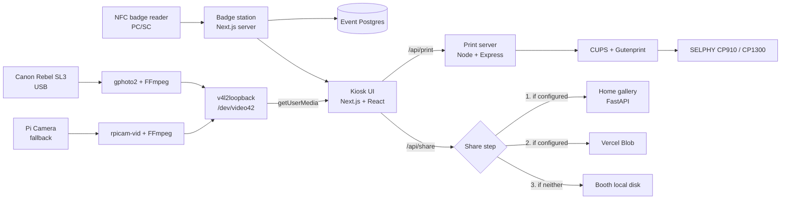

# Selphy Photobooth

A touch-screen photo booth for a hackathon. A Canon DSLR feeds live view to a Raspberry Pi kiosk, guests check in with an NFC badge, and every printed strip carries a QR code that opens the guest's photos.

**120 parties · ~200 prints · StormHacks 2026**

<!-- CAD-RENDERS: enclosure renders go here -->

This repository is the booth software and device setup as it ran at StormHacks 2026. It is a solo build: software, touch UI, print rendering, hardware integration and the printer and display enclosure. Illustrations and brand assets came from the StormHacks 2026 design team (see [Credits](#credits)).

## What it does

1. **Scan.** The guest taps a badge on the NFC reader, or skips. An accepted hacker earns points on their first completion of the event challenge, and the tap is saved with their photos for the gallery admin view.
2. **Mode.** Pick **Two Strips** (four photos stacked into two identical 2×6″ strips) or **Full Frame** (a 2×2 grid on a 4×6″ sheet), and a 3, 5 or 10 second countdown between shots.
3. **Shoot.** One tap takes four automatic shots from the live view. The live preview is mirrored; the print is not.
4. **Review.** Choose one of eight frame designs (including a sponsor frame), optional stickers, tagline and confetti, up to three copies, or retake all. The guest then chooses whether the photos are listed publicly on the gallery.
5. **Print and share.** The strip is uploaded and the printer job waits for the share link, so the printed strip carries its QR code. The guest's full-resolution shots are attached to the gallery photo after the print is sent.
6. **Done.** The screen shows the QR code for the digital copy and returns to the scan screen after 45 seconds or on tap. Mode, shoot and review screens return to scan after 60 seconds without touch. If the printer is jammed or out of paper, the screen says so in plain words, and once the strip is queued it shows how many prints are ahead of it.

Behind the guest flow there are three reliability features for running unattended at an event:

- **Camera recovery.** The booth notices a frozen or dropped live view and reconnects without restarting the kiosk.
- **Printer problem handling.** Jams, paper, ink and open covers are read from CUPS. A print sent in one of those states is held in the queue instead of failing, and the guest sees a clear status.
- **Staff panel.** Five taps in the top-right corner of the Scan screen, then a PIN, open a panel for the print queue, Wi-Fi setup and leaving kiosk mode.

These were written after the event, in response to what went wrong at it. They are tested against fake hardware (fake CUPS and `nmcli` commands) and in Playwright. They have not yet run on the booth hardware, so the real camera, the real printer's CUPS messages and the Pi's `nmcli` output are unchecked.

## Hardware

| Component | Role |
| --- | --- |
| Raspberry Pi 5 | Runs the Next.js app, the print server and the webcam feed script. Chromium runs the kiosk UI full screen. |
| Canon Rebel SL3 | Main camera. Live view and the four shots come over USB through gphoto2. |
| Pi Camera v2 | Fallback camera, used when no Canon is on USB (`rpicam-vid`). |
| NFC reader (PC/SC) | Reads badge taps. The code targets an ACR122U-style PICC reader and drives its LED for accept and reject feedback. |
| Canon SELPHY CP910 / CP1300 | 4×6″ dye-sublimation printers, driven by CUPS and Gutenprint over USB. |
| Touch display | Kiosk screen. Layouts target 1024×600 and 1280×800 landscape displays. |
| 3D-printed enclosure | Printer and display housing, designed in Fusion 360 over four printed iterations. |

## Architecture



The kiosk UI never talks to the camera or the printer directly. The camera pipeline exposes a standard webcam device, and printing goes through a small HTTP service in front of CUPS. The gallery is a separate FastAPI service on a home server; its upload contract is documented in [docs/gallery-api.md](docs/gallery-api.md).

## Engineering highlights

- **The DSLR as a webcam.** The camera's movie stream is piped through FFmpeg into a v4l2loopback device, so the browser uses plain `getUserMedia` and never needs gphoto2. A shell supervisor switches to the Pi Camera when no Canon is detected. The SELPHY printers share Canon's USB vendor ID, so detection filters them out by product name.
- **One renderer for preview, share and print.** Print geometry lives in `lib/print/layouts.ts` for a 1200×1800 sheet at 300 DPI. The grid is laid out landscape and rotated only for the printer, and the same canvas renderer produces the review preview, the shareable image and the print.
- **A QR code on every strip, with fallbacks.** The share step tries the home gallery, then Vercel Blob, then local disk (see the diagram). The print waits for the link so the QR is on the paper. If the upload fails entirely, the strip still prints without a QR, and the guest still sees the failure on the Done screen.
- **Printing that cannot stall the booth.** The print server wraps `lp`, `lpstat`, `lpq`, `cupsenable` and `cupsaccept`. It rejects jobs for a disabled or offline printer, reports queue depth, and exposes a resume endpoint that the Review screen's printer chip calls. Shooting never waits on printer state.
- **Printer faults as states, not errors.** `print-server/printerState.mjs` is a pure module that classifies the text of `lpstat` into ready, busy, jammed, out of paper, out of ink, cover open, offline or disabled, and maps each to a short guest message ("Printer jammed — staff are on it"). It skips device description lines, so a printer called "Ink Station" is not read as out of ink. A mechanical fault still accepts the print and CUPS holds it, so the guest's strip comes out once staff clear the fault. The Done screen polls the queue and shows how many prints are ahead of the guest's, and an unreadable queue is never mistaken for a finished print.
- **Camera recovery in two layers.** On the Pi, the webcam script watches ffmpeg's frame counter and restarts a feed that has stalled for 5 seconds. A Canon that is on USB but never gives a frame is reset with `gphoto2 --reset`, and after three failed tries the Pi Camera takes over until the Canon is unplugged. Source switches wait out a short USB drop, so a brief glitch does not restart the kiosk. In the browser, `useCamera` listens for the video track ending or staying muted and reopens it with backoff (0.5 s up to 5 s), asking for a volunteer after four failures while it keeps retrying. The shoot screen restarts a feed with no new frame and never takes a photo from a frame older than 1.5 seconds. The backoff and stall checks are pure functions in `components/booth/cameraRecovery.ts`.
- **A staff panel that is safe to leave on a public kiosk.** Hidden behind a five-tap gesture and a 4 to 8 digit PIN from `STAFF_PIN`; with no valid PIN set, the panel is off. The PIN is compared in constant time, five wrong guesses lock every staff route for a minute (one global counter, so rotating addresses does not help), and the PIN is held in memory only. Staff routes get no CORS headers and are reached through a Next.js proxy, so a web page cannot try PINs. The panel shows the queue and can cancel a job, clear the queue, resume the printer, and reprint any of the last 20 saved strips. Inputs that reach `lp`, `nmcli` or `pkill` are validated and passed as argument arrays, never through a shell.
- **Wi-Fi setup and a way out of kiosk mode.** A Wi-Fi tab scans and joins networks through `nmcli`, with an on-screen keyboard for the password, since the kiosk has no physical one. The password is validated for the network's security type and is never logged or saved by the print server. A Booth tab closes the kiosk after a confirm, which opens the desktop; a Back to Booth launcher starts it again. A polkit rule lets the print server's user scan and join networks without a password prompt.
- **Two printers at the event.** To keep queues moving through thermal throttling, the booth ran two SELPHY printers during StormHacks. The public code targets one CUPS queue through `PRINTER_NAME`; the routing used at the event is not part of this repository.
- **Hardware debugging.** A SELPHY was disassembled and its supply voltages and MCU-to-motor-controller communication were probed during jammed and normal runs, to test whether the jams were electrical. This repository makes no root-cause claim.

## Tech stack

- **Kiosk app:** Next.js 15 (App Router), React 19, TypeScript, Tailwind CSS 3
- **Print path:** Node.js with Express, CUPS, Gutenprint, canvas-based print renderer
- **Camera:** gphoto2, FFmpeg, v4l2loopback, rpicam-vid
- **Badges:** nfc-pcsc over PC/SC, Postgres via `@neondatabase/serverless`
- **Sharing:** FastAPI photo gallery over Tailscale Funnel, Vercel Blob, `qrcode`
- **Ops:** systemd units, labwc and Chromium kiosk, udev and polkit rules, Fusion 360 for the enclosure

## Tests

The print server has tests in `print-server/test/`, run with `cd print-server && npm test` (Node's built-in test runner). They never touch real hardware. `print-server/test/fakes/` holds stand-in `lp`, `lpstat`, `lpq`, `cancel`, `cupsenable`, `cupsaccept`, `nmcli` and `pkill` commands that read their state from a temporary directory. A test starts the real server on a random port with the fakes first on `PATH`, sets the fake printer to jammed, offline or empty, and checks what the HTTP API does. Separate test files cover the printer-state parser, print history, the Wi-Fi parsers and validators, the PIN lock-out and the staff routes. The booth UI recovery paths were checked in Playwright. The CUPS and `nmcli` text in the fakes is modelled on documented output, not captured from the booth's printer.

## Repository layout

```
app/                 Next.js routes: kiosk page, /view guest page, /dev/print and /dev/brand harnesses, API routes
components/          Booth screens (scan, mode, shoot, review, done), camera recovery hooks, and brand UI primitives
components/staff/    Staff panel: PIN pad, printer and queue tab, Wi-Fi tab, Booth tab, on-screen keyboard
lib/print/           Print layouts, frame renderer, capture crop
lib/badge/           NFC reader, NDEF parsing, tap-to-challenge logic
lib/*Client.ts       Gallery, Vercel Blob, local-disk and CUPS clients; share helpers
print-server/        Express wrapper around CUPS and nmcli: printer state, print history, Wi-Fi, staff routes
print-server/test/   Node tests, with fake CUPS and nmcli commands in test/fakes/
deploy/pi/           systemd units, webcam feed script, kiosk launcher, Back to Booth launcher, udev/polkit rules, v4l2loopback config
docs/                Gallery API, post-event issue list, next issues, redesign plan
design/              Brand guide notes and reference artwork
public/brand/        Illustrations, logos and the sponsor mark used on frames
scripts/brand/       Generates lib/brand/shapes.ts from the brand SVGs
instrumentation.ts   Starts the badge reader when the Next.js server boots
```

## Running it

### Development

Requires Node.js and pnpm.

```sh
pnpm install
pnpm print-server:install        # print-server has its own dependencies
cp .env.example .env.local       # fill in only what you need
pnpm dev                         # Next.js on :3001 and the print server on :3847
```

Open http://localhost:3001. Without a printer configured, the Review screen shows the printer as offline, but the booth still shoots and shares. Set `DISABLE_NFC=1` to skip the badge reader, or leave `DATABASE_URL` empty and use **Skip Scan**. The camera step uses the browser's `getUserMedia`, so a laptop webcam works for testing.

For a production build:

```sh
pnpm build
pnpm start                       # Next.js on :3001
```

The print layouts can be checked without a camera or printer at `/dev/print`, which renders every mode and frame with fake photos.

### Raspberry Pi deployment

`deploy/pi/README.md` has the full steps. In outline:

1. **Printer.** Install `printer-driver-gutenprint`, then add the SELPHY queue with `lpadmin` using the Gutenprint `canon-cp910` driver over USB. Set `PRINTER_NAME` and `CUPS_MEDIA_OPTION=Postcard` in `.env.local`.
2. **NFC.** Install `pcscd` and `libpcsclite-dev`.
3. **System files.** Copy the files in `deploy/pi/` to where the README lists them: the two unit files to `/etc/systemd/system/`, the two scripts to `/usr/local/bin/`, `v4l2loopback.conf` to `/etc/modprobe.d/` (with `v4l2loopback` added to `/etc/modules-load.d/`), and the PC/SC rule to `/etc/polkit-1/rules.d/`. Edit `User=` and `WorkingDirectory=` in the units to match your account.
4. **Services.** `sudo systemctl daemon-reload` then `sudo systemctl enable --now photobooth-webcam photobooth`. The `photobooth` unit runs `pnpm dev`, which serves the app and print server.
5. **Kiosk.** `photobooth-kiosk.sh` waits for the app, then opens Chromium full screen. It is launched from the labwc autostart file through `lwrespawn`.

Logs are in `/var/log/photobooth-webcam.log` (the camera feed) and `journalctl -u photobooth` (the app and print server).

### Configuration

Set in `.env.local`. `.env.example` lists them with placeholder values.

| Variable | Purpose |
| --- | --- |
| `PRINTER_NAME` | CUPS queue to print to. Empty uses the CUPS default. |
| `CUPS_MEDIA_OPTION` | CUPS page size. Defaults to `Postcard`. |
| `PRINT_SERVER_PORT` | Print server port. Defaults to 3847. |
| `STAFF_PIN` | 4 to 8 digits. Enables the staff panel and its print-server routes. Empty, or any other value, leaves the panel off. |
| `PRINT_HISTORY_DIR` | Where the last 20 printed strips are saved for staff reprints. Defaults to a cache folder in the home directory. |
| `PRINT_SERVER_URL` | Where the Next.js server finds the print server. Defaults to localhost on `PRINT_SERVER_PORT`. |
| `GALLERY_UPLOAD_URL`, `GALLERY_API_KEY` | Home gallery and an upload-only key. Optional. Keys expire, see [docs/gallery-api.md](docs/gallery-api.md). |
| `BLOB_READ_WRITE_TOKEN` | Vercel Blob credentials for the second share option. Optional. |
| `DATABASE_URL`, `CHALLENGE_ID` | Event Postgres database and the challenge that badge taps complete. |
| `DISABLE_NFC`, `TAP_COOLDOWN_MS` | Skip the badge reader. Cooldown between taps of the same badge, default 2500 ms. |

## Roadmap

### In progress

- Run the reliability work above on the booth hardware: the real camera and printer, the Pi's `nmcli` output, and leaving and returning to the kiosk.
- A hotspot and setup page for a booth that boots with no known network.
- WEP networks are refused, because the WPA password rules apply to them too.

### Next

From the open issue list in `docs/next-issues.md`:

- Alerts to a Discord channel when a print or the booth fails, one alert per error until it clears.
- Restyle the gallery's photo pages to match the booth, or point the QR code at a booth-styled page.
- Retry and an offline spool for uploads. Today a failed upload falls back and is not retried.
- A shorter upload timeout, or showing the fallback QR first when the gallery is slow.
- A visible warning on the booth when uploads fail because the key has expired.
- A moderation step for public photos.
- A start-screen hint that the otter can be tapped.

Hardware, from the post-event list: an adjustable camera mount, an enclosure opening that reaches the printer power button, and a slide-in back cover.

## Credits

- Illustrations, logos and brand assets by the StormHacks 2026 design team. The brand guide notes and reference artwork in `design/` and `public/brand/` came from their design system (Shoutout Keyaan Vegedani).
- Original Photobooth web app design and verification by Brendan Shen
- Typefaces: Fraunces and Inter, both under the SIL Open Font License (license files in `app/fonts/`).
- Built on open-source software including Next.js, React, CUPS, Gutenprint, gphoto2, FFmpeg, v4l2loopback, nfc-pcsc and qrcode.
