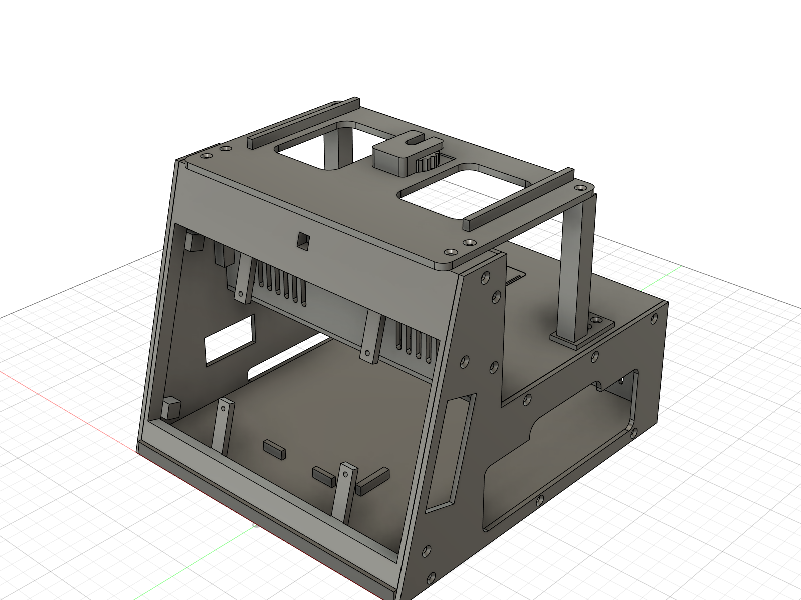

# Selphy Display Box (v7): CAD, printing and assembly

The enclosure for the Display Stand V4 screen (8" DSI + Quectel Pi, bare, bolted to the display) with a Canon SELPHY CP910 behind it. Prints exit on the **right**, and the paper shuttle exits the **left** straight into open air.

Overall: **208 W x 232 D x 171 H mm**. The DSLR platform adds 15 mm on top. Walls are 3 mm. Every part fits a 256 mm print bed.

## What is in this folder

| Folder | Contents | Use it for |
|---|---|---|
| `stl/` | 12 printable STL files, one per printed piece. The legs are two files: `DSLR_Leg_R.stl` and `DSLR_Leg_L.stl`, which are mirror images. | Printing (open in any slicer) |
| `step/` | 11 STEP files, one per part. `DSLR_Legs.step` holds both legs. | Other CAD tools |
| `fusion/` | Fusion 360 archives: one per part, plus `Selphy_Display_Box_V1_assembly.f3d`, the whole enclosure assembly with all 11 parts in their design positions. | Opening and editing in Fusion 360 |
| `renders/` | Renders of the assembly. | Reference |

The Fusion 360 document is **Photobooth / Selphy Display Box V1**, and these files are from its latest version (v7, see below). The assembly archive contains the enclosure parts only. The document also has reference models for the display, the Pi, the camera and the printer, which the enclosure is designed around. They are not included because they are third-party models.

Versions (Fusion / git):
- v5 = **baseline** (git tag `baseline`)
- v6 = flush-front bezel screwed into the display's own mounting points, vertical camera module,
  DSLR thumbwheel mount, Surge mark on the back door
- v7 = camera board flush on the plastic (mounted upside down) with a tight lens hole, DSLR moved back on a
  bridge platform over the deck, Surge mark on the deck hatch, wordmark removed

## Printing

There are 12 printed pieces. Print each one with the orientation in the table, using the file in `stl/`.

| Part | File | Qty | Size (mm) | Orientation | Notes |
|---|---|---|---|---|---|
| Base | `Base.stl` | 1 | 232 x 202 x 15 | ribs down (floor up) | 3 mm floor bridges between ribs (max span ~74 mm) |
| Side panels | `Side_L.stl`, `Side_R.stl` | 1 each | 232 x 171 x 3 | flat | countersinks face up |
| Bezel (screen frame + tower top) | `Bezel.stl` | 1 | 202 x 162 x 73 | front face on the bed | tree supports under the 4 display struts and the tower-top bosses |
| Deck (printer lid) | `Deck.stl` | 1 | 202 x 157 x 11 | top face down, lips up | |
| Rear wall | `Rear_Wall.stl` | 1 | 202 x 88 x 11 | outer face down | |
| Back door | `Back_Door.stl` | 1 | 203 x 74 x 5 | outer face down | Surge mark debossed 0.8 mm into the first layers (swap filament for a 2-colour logo) |
| Hatch | `Hatch.stl` | 1 | 109 x 73 x 3 | top face down | second Surge mark, same trick |
| DSLR platform | `DSLR_Platform.stl` | 1 | 190 x 124 x 15 | plate down | wheel cavity bridges 31 mm, no supports |
| DSLR legs | `DSLR_Leg_R.stl`, `DSLR_Leg_L.stl` | 1 each | 18 x 36 x 88 | foot down | mirror images, so print one of each |
| DSLR thumbwheel | `DSLR_Thumbwheel.stl` | 1 | 30 dia x 7 | flat | hex pocket down |

Total ~705 cm3 of solid plastic.

## Hardware

- **36 x M3 heat-set inserts** (pilots dia 4.0 x 6 mm; the two in the bezel bottom are 10 mm deep, the DSLR ones 8 mm)
  Base 6, Bezel 14, Deck 10, Rear Wall 4, DSLR legs 2.
- **M3 countersunk (ISO 10642 / DIN 7991)**: 34 x M3x8 (22 side panels, 2 rear wall, 6 DSLR platform, 4 leg feet),
  2 x M3x16 (bezel from under the base).
- **4 x M2.5 x 6** pan/button head: bezel struts into the display's mounting nuts. The strut is 4 mm, the nut 1.5 mm:
  x6 fills the nut, x5 would only catch ~1 mm of thread. The tip stays well clear of the LCD.
- **4 x M1.5 x 5** self-tapping: camera board straight into the bezel (1.2 mm pilots, 3 mm deep). The model shows 3.0 mm
  holes in the camera board; if yours really are that big, add small washers so the M1.5 heads don't pull through.
- **1 x 1/4"-20 x 1/2" hex bolt** (7/16" hex head) for the DSLR thumbwheel: the head sits in the wheel's hex pocket and
  ~5.1 mm of thread sticks up above the pedestal (~4 turns engaged, T3i socket is ~7.6 mm deep). Don't go longer than 1/2".
  Optional 1 mm rubber pad on the pedestal.
- **Right-angle mini-USB (mini-B) cable** Pi -> CP910: the pocket in front of the printer's USB port is ~24 mm deep.
- Optional: stick-on rubber feet on the base ribs.

## Assembly

Work through these in order. The part names match the files in `stl/`.

1. Press all inserts (base edges, bezel, deck lips + leg bosses, rear-wall lips, leg tops).
2. Hold the **bezel** face-up and lower the display module (Pi already on it) in **from the front** until its four
   mounting nuts sit on the struts. Turn it over and drive 4 x M2.5x6 through the struts. The glass ends flush with the frame.
3. Put the **camera** module in from behind, **upside down** (connector at the bottom, it drops into its recess). The lens
   goes into the square hole and the board sits flat on the plastic. Drive 4 x M1.5x5. Route the ribbon down and back to the Pi.
   Set the camera to rotate 180 deg in software (e.g. `rotation=180` / `--rotation 180`).
4. Stand the bezel on the **base**, 2 x M3x16 countersunk up through the base.
5. Screw the **right side** on (base, bezel). Put the **deck** and **rear wall** in and screw them to the right side.
6. Route cables: mini-USB from a Pi USB port, along the floor in front of the printer bay, to the pocket at the left. Pi USB-C power up and out of the rear-wall cable slot.
7. Screw the **left side** on. Every screw goes in from outside through a countersunk hole.
8. Slide the **CP910** in from the back (ink door facing you, cassette side to the right). Plug in DC-in through the left window, and mini-USB through the left window pocket. Insert the paper cassette from the right.
9. Drop the **back door** tongue into the base groove and push the top in until both side detents click. Press the **hatch** in.
10. **DSLR (optional)**: screw the two **legs** to the deck (2 x M3x8 each, the feet sit behind the platform so the screws stay reachable).
    Lay the **platform** on the tower top, rear wall and legs; 4 x M3x8 into the tower top, 1 x M3x8 into each leg.
    Slide the **thumbwheel** with its bolt into the pedestal from the back.

## Using it

| Task | How |
|---|---|
| Refill paper (18 sheets) | pull the cassette out of the right side |
| Change ink | unclip the back door (finger notch at the top), open the printer's ink door |
| Power button / printer LCD | lift the hatch in the deck (finger notch on its back edge, behind the DSLR platform) |
| Clear a jam / remove printer | door off, remove cassette, unplug DC (left window), pull printer back ~10 cm, unplug mini-USB, slide out |
| Pi USB / Ethernet | window in the right side of the screen tower |
| DSLR | hold the T3i's tripod socket on the bolt tip and spin the thumbwheel (reach it from the back or the sides). The wheel can only rise 0.6 mm, so the thread pulls the camera down onto the pedestal and the last turn clamps it. Keep the wheel in its slot until the camera is on; it can slide out the back when loose. |

Leave ~15 cm clear on the left for the paper shuttle and room on the right for the cassette and prints.
The DSLR's tripod socket sits at Y 125 (just behind mid-depth), so its lens front lands about over the front edge of the base.

## Estimates to check against the real CP910

These values are estimates in the design. Check them against the real printer before printing a second set.

| What | Current value | Where |
|---|---|---|
| Printer envelope | 178 x 127 x 60.5 (+1 mm per side) | `PR_*` |
| Cassette protrusion / width / height | 100 / 112 / Z 11-29 | `CAS_*`; right window is 130 x 42 + notch |
| Rear paper slot, DC-in | covered by one 185 x 51 left window | `LEFT_WIN` |
| Mini-USB port | assumed on the display-facing side near the rear | pocket Y 22-46 |
| Power button / LCD | hatch opening X -50..22, Y 95..205 (the front part sits under the DSLR platform, ~88 mm of hand room) | `HATCH` |

## Source

The STEP, F3D and STL files were exported from the Fusion 360 document **Photobooth / Selphy Display Box V1** (its latest version). The Python scripts that generated the model in Fusion are not in this repository yet. They hard-code a local path, so they need cleaning before they can be shared.
